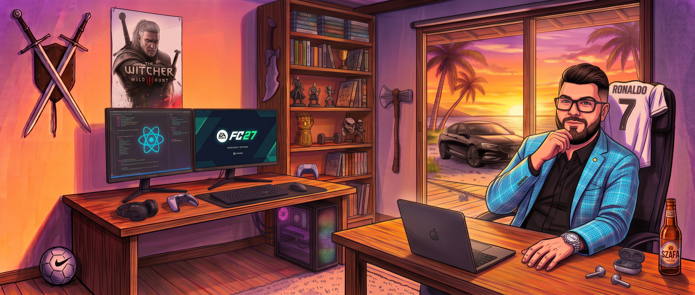

  <!-- HERO WORKSPACE BANNER -->
  
    

  <!-- RELIABLE ANIMATED HEADER BANNER -->
  
   
  

    

  <!-- MODERN ICON + BUTTON SOCIAL LINKS -->
  <table align="center">
    <tr>
      <td align="center" width="160">
        <a href="https://linkedin.com/in/jmichalski00" target="_blank">
           
          
        </a>
      </td>
      <td align="center" width="160">
        <a href="mailto:michalskijakubaleksander@gmail.com">
           
          
        </a>
      </td>
      <td align="center" width="160">
        <a href="https://github.com/michalskijakub" target="_blank">
           
          
        </a>
      </td>
      <td align="center" width="160">
        <a href="https://www.google.com/maps/place/%C5%81%C3%B3d%C5%BA,+Poland" target="_blank">
           
          
        </a>
      </td>
    </tr>
  </table>

<!-- NEON DIVIDER -->

##  About Me

<blockquote>
  <h3>👋 Hello there! I'm <b>Jakub</b> — a <b>Frontend & Mobile Developer</b> based in Łódź, Poland.</h3>
  

    🚀 Skilled in <b>React</b>, <b>Vue.js</b>, and <b>React Native</b>, with strong hands-on experience in building responsive web & mobile applications and integrating complex <b>e-commerce platforms</b> (<i>Shopify, Magento, WooCommerce, PrestaShop, Shoper, IdoSell</i>).
  

  

    🎨 I combine deep technical expertise with modern <b>UX/UI principles</b> to deliver high-quality, performant, and visually engaging solutions from scratch.
  

  

    🤖 Thriving in <b>Agile environments</b>, I focus on workflow optimization using <b>AI tools</b> and cross-team collaboration to solve real business problems and meet user needs.
  

</blockquote>

<!-- NEON DIVIDER -->

## 🛠️ Skills & Tech Stack

### 🎨 Frontend

  &nbsp;
  &nbsp;
  &nbsp;
  &nbsp;
  &nbsp;
  

### 💻 Programming Languages

  &nbsp;
  &nbsp;
  &nbsp;
  &nbsp;
  &nbsp;
  

### 🗄️ Backend / Data

  &nbsp;
  &nbsp;
  &nbsp;
  &nbsp;
  

### ⚙️ Tools & Workflow

  &nbsp;
  &nbsp;
  &nbsp;
  &nbsp;
  &nbsp;
  
  &nbsp;
  

<!-- NEON DIVIDER -->

## 💼 Experience *(Click to expand)*

  
<b>🚀 Junior Product Engineer @ Romify</b> &nbsp;—&nbsp; <code>May 2026 – Currently</code>

   
  <blockquote>
    <ul>
      <li>📱 Develop and maintain the mobile application using <b>React Native CLI</b>, managing native configurations without Expo.</li>
      <li>⚡ Implement new product features from scratch, focusing on clean code, responsiveness, and app performance.</li>
      <li>🛠️ Configure, test, and debug application builds using <b>Android Studio</b> and <b>Xcode</b> simulators.</li>
      <li>🔥 Integrate and manage <b>Firebase</b> services to support backend functionalities and monitor app stability.</li>
      <li>🍎 Troubleshoot mobile-specific technical issues and ensure smooth deployments across <b>iOS and Android</b> platforms.</li>
      <li>🤝 Collaborate closely with the product team to translate business requirements into technical solutions.</li>
    </ul>
  </blockquote>

  
<b>🔍 Junior Frontend Developer / Integration Specialist @ Luigi's Box</b> &nbsp;—&nbsp; <code>March 2025 – April 2026</code>

   
  <blockquote>
    <ul>
      <li>🔌 Integrated Luigi's Box search and discovery tools with multiple client e-commerce websites using <b>Vue.js</b> and <b>JavaScript</b>.</li>
      <li>📊 Processed client data from <b>XML, CSV, and JSON</b>, ensuring accurate API integration.</li>
      <li>🎨 Styled and customized UI components based on <b>Figma</b> designs, adhering to client branding.</li>
      <li>🚀 Debugged and optimized frontend code for performance and cross-browser compatibility.</li>
      <li>🤝 Collaborated directly with clients to implement feature requests, onboard their platforms, and coordinated with backend developers.</li>
      <li>🧱 Built reusable components and templates to speed up future integrations and conducted QA testing before deployment.</li>
      <li>🛒 Worked with e-commerce platforms including <b>WooCommerce, Magento, Shoper, PrestaShop, and IdoSell</b>.</li>
    </ul>
  </blockquote>

  
<b>🏦 Technical Business Expert @ Commerzbank</b> &nbsp;—&nbsp; <code>November 2023 – July 2024</code>

   
  <blockquote>
    <ul>
      <li>🔗 <b>API Onboarding</b> – creating new APIs for internal and external clients.</li>
      <li>⚙️ Supported internal processes and system improvements.</li>
      <li>📋 Worked with <b>Jira and Confluence</b> in an Agile team environment.</li>
      <li>🤝 Collaborated with cross-functional teams to deliver process optimizations.</li>
    </ul>
  </blockquote>

  
<b>💻 Junior Frontend Developer @ DeveloArt</b> &nbsp;—&nbsp; <code>May 2023 – October 2023</code>

   
  <blockquote>
    <ul>
      <li>🌐 Developed responsive web applications using <b>React</b> and <b>Vue.js</b>.</li>
      <li>🎨 Implemented UI based on <b>Figma</b> designs.</li>
      <li>🔥 Handled data integration using <b>Firebase</b>.</li>
      <li>🚀 Debugged and improved application performance.</li>
    </ul>
  </blockquote>

  
<b>🥪 Junior Website Developer @ KanapkaMan</b> &nbsp;—&nbsp; <code>October 2022 – February 2023</code>

   
  <blockquote>
    <ul>
      <li>📱 Built websites using <b>React</b> and <b>Vue.js</b>.</li>
      <li>📐 Ensured responsive design across devices.</li>
      <li>✨ Improved UI based on modern <b>UX principles</b>.</li>
    </ul>
  </blockquote>

  
<b>☁️ Junior Salesforce Developer @ Craftware</b> &nbsp;—&nbsp; <code>October 2021 – February 2022</code>

   
  <blockquote>
    <ul>
      <li>🤖 Developed <b>Salesforce</b> automation tools and basic features.</li>
      <li>☁️ Worked with <b>Einstein Bots</b> and cloud solutions.</li>
      <li>📈 Collaborated with the team to implement CRM improvements.</li>
    </ul>
  </blockquote>

<!-- NEON DIVIDER -->

## 🎓 Education Timeline

<blockquote>
  

    🟢 <code><b>2023 – 2024</b></code> &nbsp;───►&nbsp; 🏛️ <b>Lodz University of Technology</b> 
    &nbsp;&nbsp;&nbsp;&nbsp;&nbsp;&nbsp;┃ &nbsp;&nbsp;&nbsp;&nbsp;&nbsp;&nbsp;&nbsp;&nbsp;&nbsp;&nbsp;&nbsp;&nbsp;&nbsp;&nbsp;&nbsp;&nbsp;&nbsp;&nbsp;&nbsp;&nbsp;&nbsp;&nbsp;&nbsp;&nbsp;&nbsp;&nbsp;&nbsp;&nbsp;&nbsp;&nbsp;&nbsp;&nbsp;&nbsp; <i>Computer Science — UX/UI, Frontend</i> 
    &nbsp;&nbsp;&nbsp;&nbsp;&nbsp;&nbsp;┃ 
    🔵 <code><b>2022</b></code> &nbsp;&nbsp;&nbsp;&nbsp;&nbsp;&nbsp;&nbsp;&nbsp;&nbsp;&nbsp;&nbsp;&nbsp;&nbsp;───►&nbsp; 🌍 <b>Hanze University of Applied Sciences Groningen</b> 
    &nbsp;&nbsp;&nbsp;&nbsp;&nbsp;&nbsp;┃ &nbsp;&nbsp;&nbsp;&nbsp;&nbsp;&nbsp;&nbsp;&nbsp;&nbsp;&nbsp;&nbsp;&nbsp;&nbsp;&nbsp;&nbsp;&nbsp;&nbsp;&nbsp;&nbsp;&nbsp;&nbsp;&nbsp;&nbsp;&nbsp;&nbsp;&nbsp;&nbsp;&nbsp;&nbsp;&nbsp;&nbsp;&nbsp;&nbsp; <i>Computer Science — Erasmus Program (Internship: Oct 2022 – Dec 2022)</i> 
    &nbsp;&nbsp;&nbsp;&nbsp;&nbsp;&nbsp;┃ 
    🟣 <code><b>2019 – 2023</b></code> &nbsp;───►&nbsp; 🏛️ <b>Lodz University of Technology</b> 
    &nbsp;&nbsp;&nbsp;&nbsp;&nbsp;&nbsp;&nbsp;&nbsp; &nbsp;&nbsp;&nbsp;&nbsp;&nbsp;&nbsp;&nbsp;&nbsp;&nbsp;&nbsp;&nbsp;&nbsp;&nbsp;&nbsp;&nbsp;&nbsp;&nbsp;&nbsp;&nbsp;&nbsp;&nbsp;&nbsp;&nbsp;&nbsp;&nbsp;&nbsp;&nbsp;&nbsp;&nbsp;&nbsp;&nbsp;&nbsp;&nbsp; <i>Computer Science — Web Development</i>
  

</blockquote>

<!-- NEON DIVIDER -->

## 🎯 Hobbies & Interests

  <table>
    <tr>
      <td align="center" width="200">
         
        
        <h3>New IT Tech</h3>
      </td>
      <td align="center" width="200">
         
        
        <h3>Football</h3>
      </td>
      <td align="center" width="200">
         
        
        <h3>Games</h3>
      </td>
      <td align="center" width="200">
         
        
        <h3>Fishing</h3>
      </td>
    </tr>
  </table>

<!-- NEON DIVIDER -->

## 📊 Most Used Languages & Activity

  
  

